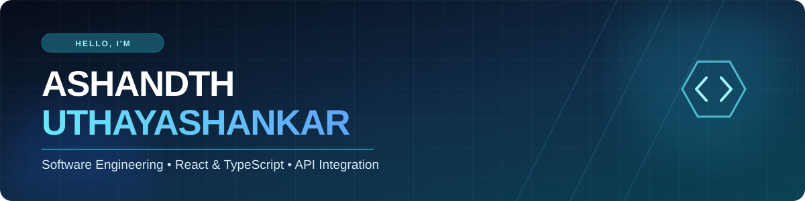

<!-- GitHub Profile README | Ashandth Uthayashankar -->

### Build. Teach. Create.

**Turning thoughtful ideas into useful software — from polished web experiences to intelligent connected systems.**

---

## 👋 Hello, I'm Ashandth

I'm a **software engineering undergraduate at SLIIT**, based in **Colombo, Sri Lanka**, with hands-on experience delivering responsive front-end applications, integrating APIs, troubleshooting real-world defects, and explaining technology to others.

My work sits at the intersection of **software engineering, AI-powered systems, and technical education**. At **Alchemy Solutions**, I worked with React/Next.js applications, authentication, REST APIs, and collaborative engineering workflows. Beyond client work, I build projects involving TypeScript, desktop software, robotics, and offline voice interaction.

- 🔭 **Building:** Front-end experiences, API-connected applications, and AI/robotics projects
- 💻 **Especially interested in:** TypeScript, React, integration engineering, developer tools, and intuitive interfaces
- 🤝 **Experienced with:** Agile collaboration, debugging, code reviews, demonstrations, and technical mentoring
- 🎓 **Education:** BSc (Hons) IT — Software Engineering specialization, **SLIIT** (final exam scheduled for **13 Nov 2026**)
- 🧑‍🏫 **Beyond coding:** Teaching programming, AI, STEM, and mechatronics at **Igniter Space**
- 📍 **Location:** Colombo, Sri Lanka

> **My approach:** Understand the problem. Build deliberately. Test the edge cases. Keep learning.

---

## ⚡ What I Work With

**Front-end & user experiences**

**Back-end, APIs & data**

**AI, systems & development workflow**

---

## 🚀 Selected Work

### 01 · Civic Law Initiative — Civic Information Platform

**React · TypeScript · Vite · Tailwind CSS · Supabase · React Hook Form · Zod**

A civic information experience with responsive interfaces and API-connected functionality. I worked on component-based UI development, authentication/data flows, typed forms, and validation-driven multi-step interactions.

**Engineering highlights**
- Built reusable React interfaces with TypeScript and responsive layouts.
- Used schema-derived form types and **Zod** validation to support safer user input.
- Implemented form-step checks and submission error feedback to improve reliability.
- Integrated authentication and data-management functionality.

**[🌐 Visit live site](https://civiclawinitiative.lk)** · **[💻 Source repository](https://github.com/ashandth0309/Civic_Law)**

### 02 · BUDDY 2.0 — Emotionally Intelligent Companion Robot

**Python · Vosk · TF-IDF · Logistic Regression · REST APIs · Raspberry Pi · Flutter integration**

A final-year team research project exploring an AI-powered companion robot with voice interaction, vision-related capabilities, navigation, and safety monitoring. My primary contributions were the **offline voice system and integration between robot services and the companion app**.

**My contribution**
- Developed an offline spoken-command pipeline using **Vosk**, TF-IDF features, and logistic regression intent classification.
- Connected command handling, voice responses, and persistent interaction memory.
- Integrated REST endpoints for the Flutter companion app, including robot status, vision-related events, and notifications.
- Worked across separately developed subsystems to identify and resolve integration issues.

**Recognition:** Presented by our team as a **Top 12 finalist at SLASSCOM Xcellerate 2026**.

**[🤖 Project site](https://buddy2website.vercel.app/)** · **[💻 Research repository](https://github.com/ashandth0309/R26-SE-040)** · **[🌐 Website repository](https://github.com/ashandth0309/BUDDY-2.0-Website)**

### 03 · Freedom Cricket Academy — Client-Facing Web Experience

**React / Next.js · Responsive UI · Client delivery**

A web project associated with my work at **Alchemy Solutions**, reflecting experience contributing to real-world interfaces, frontend functionality, debugging, and collaborative delivery.

**[🌐 View website](https://freedemsports.com/)**

### 04 · Chinthamani Manor — Desktop Hotel Management Application

**React · Electron · Tailwind CSS · Firebase**

A desktop application with role-based hotel workflows, application data management, and **PDF invoice generation**. This project reflects my interest in building practical software beyond the browser.

### 05 · CMN Distributors — Industrial Distribution Website

**Company website · Responsive product presentation**

A website showcasing industrial tools, equipment, product categories, and distribution services.

**[🌐 View website](https://cmn-six.vercel.app/home)**

<b>➕ More projects and experiments</b>

 

| Project | Focus | Explore |
| --- | --- | --- |
| **English With AI** | Interactive English learning with external AI API integration | [Repository](https://github.com/ashandth0309/english-with-ai) |
| **Multi-Agent Heart Disease Prediction** | An exploratory multi-agent machine-learning assignment | [Repository](https://github.com/ashandth0309/CTSE-Assignment-2-ML-) |
| **Personal Portfolio** | React, Vite, TypeScript, Tailwind CSS, motion, and accessible component tooling | [Live site](https://final-portfolio-lac-tau.vercel.app/) · [Repository](https://github.com/ashandth0309/Final_Portfolio) |

---

## 💼 Experience — Building and Sharing Technology

<table>
<tr>
<td width="30%" valign="top"><b>Apr 2025 – May 2026</b> Software Engineering Intern <b>Alchemy Solutions</b></td>
<td valign="top">Contributed to React and Next.js interfaces, reusable components, Figma-to-code implementation, authentication, REST API integration, debugging, testing, code reviews, and Agile teamwork. Worked on projects including <b>Innov8</b> and <b>Freedom Cricket Academy</b>.</td>
</tr>
<tr>
<td valign="top"><b>Jun 2024 – Present</b> Lead Instructor — AI & Programming <b>Igniter Space</b></td>
<td valign="top">Teach and mentor learners across STEM L1–L4, including mechatronics at L4, programming, and AI. Create hands-on challenges, demonstrate technical concepts, and support learners through debugging and guided projects.</td>
</tr>
</table>

---

## 🌍 Beyond the Code

Good engineering also depends on explaining ideas clearly, understanding people, and learning with others.

- **Youth Ambassador — U.S.–Sri Lanka Fulbright Commission (2026):** Youth leadership and community engagement.
- **Colombo District Youth Forum — American Spaces Sri Lanka:** Participation in youth-focused community and development initiatives.
- **Technical education — Igniter Space:** Helping students explore technology and develop independent problem-solving skills.
- **Creative communication:** Directed shoots and contributed voice-over work to documentary productions during my time at Alchemy Solutions.

---

## 📊 GitHub at a Glance

Language cards reflect public repository code, not a ranking of professional proficiency. Third-party cards can be temporarily unavailable.

---

## 🎯 What I'm Exploring Next

- **Developer experience:** Building clearer, more reliable interfaces for technical users.
- **Integration engineering:** Designing and connecting services, APIs, and application workflows.
- **Engineering quality:** Improving edge-case handling, testing, performance, and maintainability.
- **Human-centered AI:** Exploring practical, accessible voice and robotics experiences.

---

### Let's build something meaningful.

I'm always interested in thoughtful engineering conversations, collaboration, and opportunities to learn from teams that care about quality.

**[🌐 Portfolio](https://final-portfolio-lac-tau.vercel.app/)** · **[💼 LinkedIn](https://linkedin.com/in/ashandth-uthayashankar-8b174224b)** · **[✉️ Email](mailto:ashandth0309@gmail.com)**

*Build. Teach. Create. — and keep getting better.*

